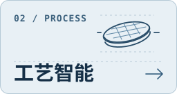
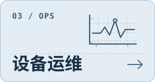

<div align="right">中文 · <a href="README_EN.md">English</a></div>

<p align="center">
  <picture>
    <source media="(prefers-color-scheme: dark)" srcset="assets/home/cover-white.jpg">
    
  </picture>
</p>

<h1 align="center">SEMI 101</h1>

<h3 align="center">半导体设备智能化学习手册</h3>

<p align="center"><em>从设备问题出发，读懂设计、工艺与运维。</em></p>

<p align="center">
  <a href="learn/README.md"></a>
</p>

<p align="center">
  <a href="#learning-map"></a>
  <a href="#research-resources"></a>
  <a href="catalog/datasets.md"></a>
</p>

---

## 🎯 项目介绍

SEMI 101 面向半导体行业新人和研究人员。设备设计研究结构怎么改，工艺智能分析轨迹怎样关联晶圆结果，设备运维判断何时排查和维护。

每个专题从一项设备任务入手，结合公开案例讲清方法、输入与验证，再给一道读图或判断练习。论文、数据和代码索引可独立查阅。

## 📚 快速开始

### 在线阅读

[读入门篇](learn/README.md) · [跳到完整章节表](#learning-map) · [直接找研究资料](#research-resources)

### 本地阅读

[下载仓库 ZIP](#offline)，解压后打开 `README.md`。也可以克隆仓库，用支持 Markdown 的编辑器阅读。

### ✨ 你将收获什么

- **理解设备模型。** 看腔室几何如何影响晶圆均匀性，判断仿真需要哪些实测量来校验。
- **读懂工艺数据。** 按晶圆和步骤关联配方、传感器时序与量测，区分预测、监控和控制。
- **分析故障与寿命。** 建立可比工况的基线，检查告警证据，并评估预警提前量。
- **定位研究材料。** 选能回答当前问题的论文、公开数据和上游实现，核对适用范围与许可。

<div><a name="学习地图"></a><a name="learning-map"></a></div>

## 📖 内容导航

各部分都可以独立阅读。点击章名直接进入该专题。

| 章节 | 关键内容 | 状&#8288;态 |
| :--- | :--- | :---: |
| [前言 · 从设备问题开始](learn/README.md) | 看懂晶圆、配方、设备轨迹和量测怎样关联 | ✅ |
| **第一部分 · 设备设计** | **仿真、孪生与优化** | |
| [D1 · 腔室仿真](learn/design.md#d1-腔室仿真) | 从腔室构型和边界条件解释晶圆均匀性 | ✅ |
| [D2 · 设备数字孪生](learn/design.md#d2-设备数字孪生) | 用实测信号校准模型，检查不同工况下的误差 | ✅ |
| [D3 · 代理模型与设计优化](learn/design.md#d3-代理模型与设计优化) | 用多保真仿真筛选方案并复核候选 | ✅ |
| **第二部分 · 工艺智能** | **配方、量测与控制** | |
| [P1 · 配方与设备轨迹](learn/process.md#p1-配方与设备轨迹) | 对齐配方步骤、传感器信号和晶圆量测 | ✅ |
| [P2 · 虚拟量测](learn/process.md#p2-虚拟量测) | 定义预测时点、切分数据，评估何时补量测 | ✅ |
| [P3 · 工艺监控与批间控制](learn/process.md#p3-工艺监控与批间控制) | 判断何时监控、加测或调整下一次加工 | ✅ |
| **第三部分 · 设备运维** | **设备状态、故障与维护** | |
| [O1 · 设备数据与状态](learn/operations.md#o1-设备数据与状态) | 关联运行状态、告警、配方和维修记录 | ✅ |
| [O2 · 故障检测与诊断](learn/operations.md#o2-故障检测与诊断) | 从异常轨迹提出可核查的故障假设 | ✅ |
| [O3 · 寿命预测与维护决策](learn/operations.md#o3-寿命预测与维护决策) | 估计剩余时间并衡量提前量与误报代价 | ✅ |

✅ 表示专题正文可读，含来源和阅读练习。

<div><a name="research-resources"></a></div>

### 研究资源

| 想找什么 | 入口 | 用法 |
| :--- | :--- | :--- |
| 论文 | [论文导读](catalog/papers.md) | 按设备问题读代表性研究，比较验证方式 |
| 数据 | [数据集总览](catalog/datasets.md) | 按任务查看信号、标签、获取方式和许可 |
| 代码 | [代码索引](catalog/code.md) | 查上游实现、依赖环境和配套数据 |
| 术语 | [术语速查](catalog/glossary.md) | 理解设备、工艺、控制与运维缩写 |

按板块查看完整目录。[设备设计](catalog/design.md) · [工艺智能](catalog/process.md) · [设备运维](catalog/operations.md)

<div><a name="offline"></a></div>

### 离线下载

> [下载当前仓库 ZIP](https://github.com/phoenixsjtu/SEMI-101/archive/refs/heads/main.zip)
>
> 压缩包包含仓库内的 Markdown 与图示。论文、数据和第三方代码由条目所列的上游提供。

## 💡 如何学习

<p align="center">
  <a href="learn/design.md"></a>
  <a href="learn/process.md"></a>
  <a href="learn/operations.md"></a>
</p>

- **刚入行。** 先读[入门篇](learn/README.md)，再选一个设备问题，把课后的关系图画出来。
- **手里已有设备数据。** 从[工艺轨迹](learn/process.md#p1-配方与设备轨迹)或[故障诊断](learn/operations.md#o2-故障检测与诊断)开始，先核对记录粒度、工况和可用标签。
- **正在做研究。** 从[数据集总览](catalog/datasets.md)选基准，再查[论文导读](catalog/papers.md)的对照方法和[代码索引](catalog/code.md)的复现条件。

## 🧭 下一步

为选定的公开设备数据补充可运行基线，逐步加入数据准备、运行命令、切分规则和评估记录。候选案例可在 [Issues](https://github.com/phoenixsjtu/SEMI-101/issues) 中提出。

## 🤝 如何贡献

- 发现术语、链接或许可标注有误，可以[提交 Issue](https://github.com/phoenixsjtu/SEMI-101/issues/new)。
- 补充专题、论文、数据或案例，可以按[收录与贡献规则](CONTRIBUTING.md)准备材料并提交 PR。

## 📎 维护与引用

由 [phoenixsjtu](https://github.com/phoenixsjtu) 维护。引用知识库时附仓库链接，使用第三方资料时按对应发布方的许可和引用说明。

```bibtex
@misc{semi101,
  title = {SEMI 101: Semiconductor Equipment Intelligence},
  author = {{phoenixsjtu}},
  howpublished = {https://github.com/phoenixsjtu/SEMI-101}
}
```
