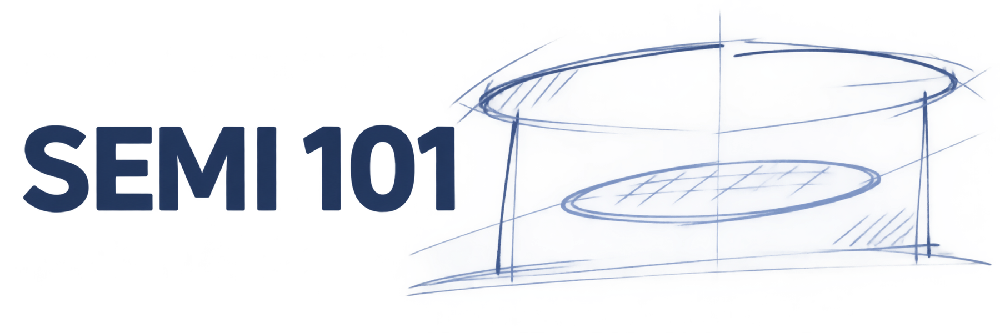
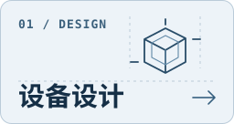
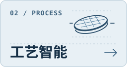
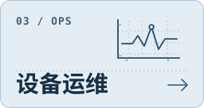

<a href="README.md">中文</a> · <strong>English</strong>

  <picture>
    <source media="(prefers-color-scheme: dark)" srcset="assets/home/cover-white.jpg">
    
  </picture>
  <h1>SEMI 101</h1>
  <h3>Semiconductor Equipment Intelligence</h3>
  
A learning and research guide to equipment design, process control, and operations.

  

  

    
    
    
  

---

## 🎯 Project overview

SEMI 101 starts with equipment questions. Why does a chamber etch unevenly? What can a process trace tell us about a wafer? When does a pressure change warrant maintenance? Each topic connects an engineering decision to the measurements, models, and evidence needed to make it.

The guide is for newcomers learning equipment fundamentals and researchers looking for papers, datasets, or upstream implementations. The chapter text and resource notes are currently in Chinese.

## 📚 Quick start

### Read online

Open the [introductory guide](learn/README.md) to see how recipes, traces, wafer measurements, and maintenance records fit together. You can also jump directly to any topic in the [chapter map](#learning-map).

### Read locally

[Download the repository ZIP](#offline), then open `learn/README.md` in a Markdown viewer.

### What you will learn

- **Design equipment.** Compare chamber layouts, connect a digital twin to measurements, and evaluate surrogate models.
- **Understand processes.** Align recipe steps and equipment traces with wafer results, then examine virtual metrology and run-to-run control.
- **Operate equipment.** Reconstruct machine states, investigate a fault, and turn a remaining-life estimate into a maintenance decision.

## 📖 Chapter map

| Chapter | Key content | Status |
| :--- | :--- | :---: |
| [Preface and first exercise](learn/README.md) | Equipment records and a wafer-level data exercise | Available |
| **Part I · Equipment design** | | |
| [D1 Chamber simulation](learn/design.md#d1-腔室仿真) | Geometry, flow, and wafer uniformity | Available |
| [D2 Equipment digital twins](learn/design.md#d2-设备数字孪生) | Measurements, model inputs, and validation | Available |
| [D3 Surrogate models and design optimization](learn/design.md#d3-代理模型与设计优化) | Fidelity, search cost, and design review | Available |
| **Part II · Process intelligence** | | |
| [P1 Recipes and equipment traces](learn/process.md#p1-配方与设备轨迹) | Recipe steps, sensor signals, and wafer alignment | Available |
| [P2 Virtual metrology](learn/process.md#p2-虚拟量测) | Prediction timing, validation, and sampling | Available |
| [P3 Process monitoring and run-to-run control](learn/process.md#p3-工艺监控与批间控制) | Process drift, feedback, and recipe adjustments | Available |
| **Part III · Equipment operations** | | |
| [O1 Equipment data and states](learn/operations.md#o1-设备数据与状态) | Events, trace data, and maintenance timelines | Available |
| [O2 Fault detection and diagnosis](learn/operations.md#o2-故障检测与诊断) | Baselines, alarms, and diagnostic evidence | Available |
| [O3 Prognostics and maintenance decisions](learn/operations.md#o3-寿命预测与维护决策) | Remaining life, warning time, and downtime | Available |

### Research resources

| Index | What you will find |
| --- | --- |
| [Paper guide](catalog/papers.md) | Reading paths grouped by equipment question |
| [Dataset catalog](catalog/datasets.md) | 12 dataset families for simulation, metrology, and equipment health |
| [Code index](catalog/code.md) | 12 upstream implementations with setup and data notes |
| [Glossary](catalog/glossary.md) | Definitions for common equipment, process, and maintenance terms |

Browse all 64 entries by topic in [equipment design](catalog/design.md), [process intelligence](catalog/process.md), or [equipment operations](catalog/operations.md).

### Offline copy

[Download the current repository as a ZIP](https://github.com/phoenixsjtu/SEMI-101/archive/refs/heads/main.zip) for the Markdown chapters, indexes, and illustrations. Follow the source links in the catalogs to obtain external data or code under their respective terms.

## 💡 How to learn

  
  
  

- **New to equipment.** Read the [preface](learn/README.md), keep the [glossary](catalog/glossary.md) nearby, and choose one track. Each topic ends with a sketch, reasoning, or decision exercise.
- **Investigating a specific question.** Start with the relevant chapter, then compare a paper and a dataset. Check the equipment context, what was measured, and how the work was validated.
- **Finding material for research.** Choose a benchmark in the [dataset catalog](catalog/datasets.md), compare methods in the [paper guide](catalog/papers.md), and check setup requirements in the [code index](catalog/code.md).

## 🗺️ Roadmap

Repository-owned runnable examples are planned. The [code index](catalog/code.md) lists upstream implementations you can examine today.

## 🤝 Contribute

Use [GitHub Issues](https://github.com/phoenixsjtu/SEMI-101/issues) to report a mistake, request a topic, or suggest a source. Read the [contribution guide](CONTRIBUTING.md) before submitting chapter edits or catalog entries.

## 📎 Maintainer and citation

SEMI 101 is maintained by [@phoenixsjtu](https://github.com/phoenixsjtu). To reference it, cite the [SEMI 101 repository](https://github.com/phoenixsjtu/SEMI-101) and the commit you used. Cite individual papers, datasets, and code at their upstream sources and follow the terms listed there.
