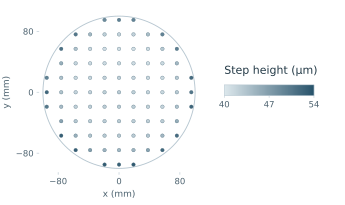

<a href="README.md">中文</a>

# SEMI 101

**A handbook on semiconductor equipment.** Start with deposition and etching, then learn to connect recipes, equipment records, and wafer measurements. The handbook chapters are in Chinese.

**[Start with wafers and process equipment](learn/foundations.md#f1-晶圆与设备工艺)** · [Browse datasets](catalog/datasets.md) · [Find papers and code](#research-resources)

## Chapters

- **[Process fundamentals](learn/foundations.md)** — How thin films grow and how plasmas remove material.
- **[Simulation, data, and control](learn/methods.md)** — Model a chamber, read sensor records by process step, and check predictions against measurements.
- **[Process development and production](learn/applications.md)** — Tune recipes, estimate wafer measurements, or investigate excursions.

## One wafer, 89 measurement sites

On this wafer, the largest step heights are near the edge. The experiment date and wafer number link the map to pressure, power, and optical spectra recorded during the BOSCH etch.

<picture>
  <source media="(prefers-color-scheme: dark)" srcset="assets/home/bosch-wafer-dark.svg">
  
</picture>

Wafer 2024-07-02_01, plotted at the measured sites. Data from Sayyed et al., <a href="https://zenodo.org/records/17122442">BOSCH dataset</a> (CC BY 4.0).

[Try the first data exercise](learn/README.md#第一个读数据练习) · [See the fields and join keys](catalog/datasets/etch.md#e01-bosch-深硅刻蚀)

## Resource index

[Dataset coverage matrix](catalog/datasets/matrix.md) · [Paper guide](catalog/papers.md) · [Code index](catalog/code.md)

Browse [equipment design](catalog/design.md) · [process intelligence](catalog/process.md) · [equipment operations](catalog/operations.md)

[Reading guide](learn/README.md) · [Glossary](catalog/glossary.md) · [Contributing](CONTRIBUTING.md) · [Download ZIP](https://github.com/phoenixsjtu/SEMI-101/archive/refs/heads/main.zip)
