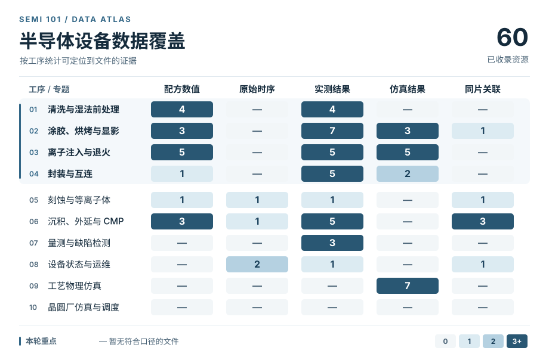

# 04 半导体设备数据集

从配方设定到机台运行、晶圆量测与仿真输出。先用覆盖矩阵选择工序，再进专题查看下载文件、字段字典和关联粒度。

<picture>
  <source media="(prefers-color-scheme: dark)" srcset="../assets/datasets/coverage-dark.svg">
  
</picture>

[查看可点击矩阵与计数口径](datasets/matrix.md) · [下载总表 CSV](datasets/inventory.csv) · [检索记录](datasets/coverage.md)

## 按工序找数据

| 专题 | 重点数据与字段 |
| --- | --- |
| **[清洗与湿法前处理](datasets/cleaning.md)** | 浴液及处理条件、去除效果、表面成像、超声空化诊断 |
| **[涂胶、烘烤与显影](datasets/coat-develop.md)** | 旋涂设定、膜厚与图形量测、显影实验、光刻胶模型 |
| **[离子注入与退火](datasets/implantation.md)** | 调束成败、注入能量与剂量、SIMS 深度剖面、离子输运仿真 |
| **[封装与互连](datasets/packaging.md)** | 键合、互连检测、热可靠性和封装仿真 |
| [刻蚀与等离子体](datasets/etch.md) | 工艺设定、设备轨迹、OES 与晶圆深度 |
| [沉积、外延与 CMP](datasets/deposition-cmp.md) | PVD 膜厚、外延光学量测与 CMP 去除率 |
| [量测与缺陷检测](datasets/metrology.md) | 参考薄膜、SEM 图像、缺陷掩膜与晶圆图 |
| [设备状态与运维](datasets/health.md) | 设备轨迹、故障注入、告警与维护事件 |
| [工艺物理仿真](datasets/simulation.md) | 刻蚀形貌、沉积剖面、光刻与电磁场 |
| [晶圆厂仿真与调度](datasets/fab.md) | 路由、设备组、搬运与批次派工 |

## 工艺轨迹、光谱和量测

**想复现虚拟量测**，先看 [BOSCH 深硅刻蚀](datasets/etch.md#e01-bosch-深硅刻蚀)、[Infineon PVD](datasets/deposition-cmp.md#p01-infineon-pvd) 和 [PHM 2016 CMP](datasets/deposition-cmp.md#p02-phm-2016-cmp)。三套数据分别提供晶圆空间量测、膜厚向量和晶圆平均材料去除率。

**想研究配方优化**，可对比 [Oxford PP100](datasets/etch.md#e02-oxford-pp100-icp) 中受控工况与光学响应的关系，以及 [ALD 饱和时间](datasets/simulation.md#ald-与刻蚀) 中工艺输入与仿真输出的关系。选数据前先确定优化的目标是光学信号、晶圆性能，还是仿真量。

## 故障与健康管理

**想复现 FDC 或 RUL**，从 [设备状态与运维](datasets/health.md) 选择与目标一致的标签。晶圆级异常、已知注入故障和距维护停机的时间分别对应三种评估问题。

## 仿真与设计

**想训练仿真代理模型**，在[工艺物理仿真](datasets/simulation.md)按目标量选择数据，例如刻蚀轮廓、膜厚剖面和光刻成像。调度和搬运属于[晶圆厂仿真](datasets/fab.md)，其样本由工厂流程与事件模型产生。

## 怎样判断一套数据够不够用

1. **先找样本单位。** 同一片晶圆可以有几百条时序采样、几十个量测点和多幅图像。训练、验证和测试先按晶圆分开，再根据问题尝试按批次、机台或时间隔离。
2. **区分配方、轨迹和量测。** 设定压力、实测压力、整片压力均值是三列不同的证据。配方编号可以用来分组，预测可调参数的效果还需要公开设定值。
3. **验证关联键和预测时点。** 工艺前优化配方和工艺后预测膜厚能使用的信息不同。先确认数据表能通过什么字段拼接，再检查这些字段在预测时是否已经可见。
4. **分别查获取方式和许可。** 文件能下载、能商用和能再分发是不同状态。目录按上游许可记录，代码、数据和模型分别核对。

[回到首页](../README.md) · [设备数据与量测教程](../learn/methods.md#t2-设备数据与量测) · [提交数据线索](../CONTRIBUTING.md)
