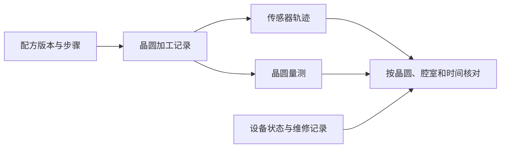

# 阅读指南

第一次接触半导体设备，可以从[晶圆与设备工艺](foundations.md#f1-晶圆与设备工艺)开始。先看材料怎样沉积和移除，再理解工程师能测到什么、能调节什么。

熟悉工艺后，从[技术方法](methods.md)学习仿真、数据、验证与控制。遇到具体任务时，可以直接查[工程应用](applications.md)，把方法和生产决策对起来。

下面用一台刻蚀设备练习这条路径。假设设备使用同一版配方，最近几批晶圆的刻蚀深度逐步变浅。你需要先把设备发生的事与晶圆上的变化对齐。

## 先认清数据里的几个对象

| 对象 | 用它回答什么 |
| --- | --- |
| 设备、模块、腔室 | 晶圆在哪个位置加工，设备事件发生在哪个部件？ |
| 晶圆、批次、加工记录 | 哪些信号、设定值和量测属于同一次加工？ |
| 配方、版本、步骤 | 哪段时序对应点火、稳定加工或结束，哪些记录可以比较？ |
| 轨迹与量测 | 设备记录了怎样的压力、功率或流量，量测又给出了怎样的晶圆结果？ |
| 告警、停机、维修 | 异常何时出现，期间做过哪些处置，处置后有哪些证据？ |

下面是一个简化的数据关系图。真实设备会采用不同的标识与事件格式，关联记录时应先核对数据字典和时间基准。[SEMI 设备数据标准索引](https://www.semi.org/en/products-services/standards/information_and_control)

## 从一个问题进入

- **结构为什么影响结果？** 看腔室结构、流动和晶圆表面反应如何进入同一个模型。[多物理场仿真](methods.md#t1-多物理场仿真)
- **设备记录能估计晶圆结果吗？** 先确定结果的定义、量测时间与预测时能看到的数据。[虚拟量测](applications.md#a2-虚拟量测)
- **偏差从哪里来？** 先检查同配方、同步骤的可比记录，再用设备事件、量测和维修证据检验假设。[根因分析](applications.md#a6-根因分析)

## 第一个读数据练习

打开 BOSCH 刻蚀公开数据的说明，找出一类工艺设定、一类等离子体观测和一类晶圆量测。画一张对照表，标出它们在加工前、加工中或加工后何时可用。然后写下你会用什么键把三者连到同一片晶圆，以及你会保留哪一批晶圆做验证。[BOSCH 刻蚀数据与字段说明](https://zenodo.org/records/17122442)

[学习导航](../README.md) · [术语速查](../catalog/glossary.md) · [数据集总览](../catalog/datasets.md)
